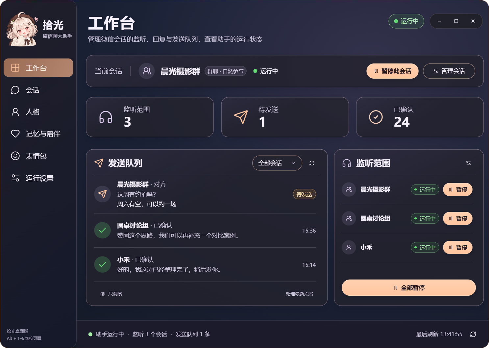
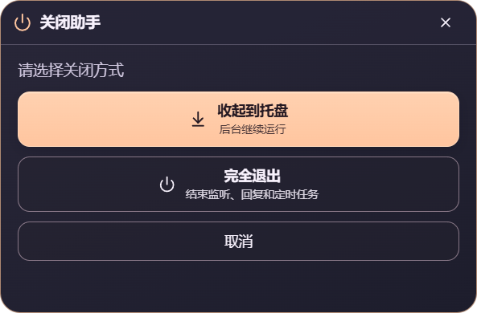
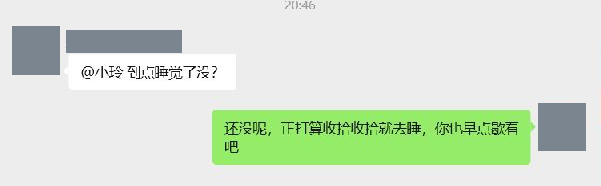
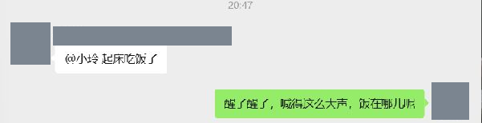
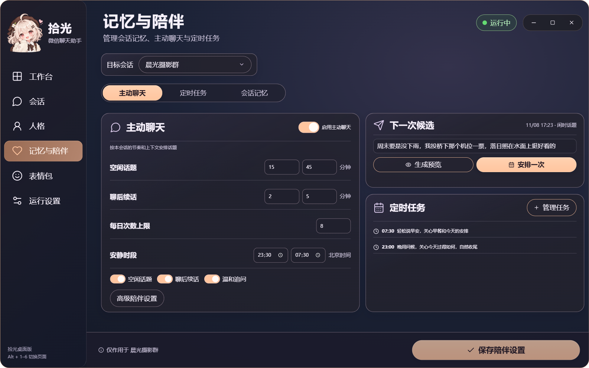
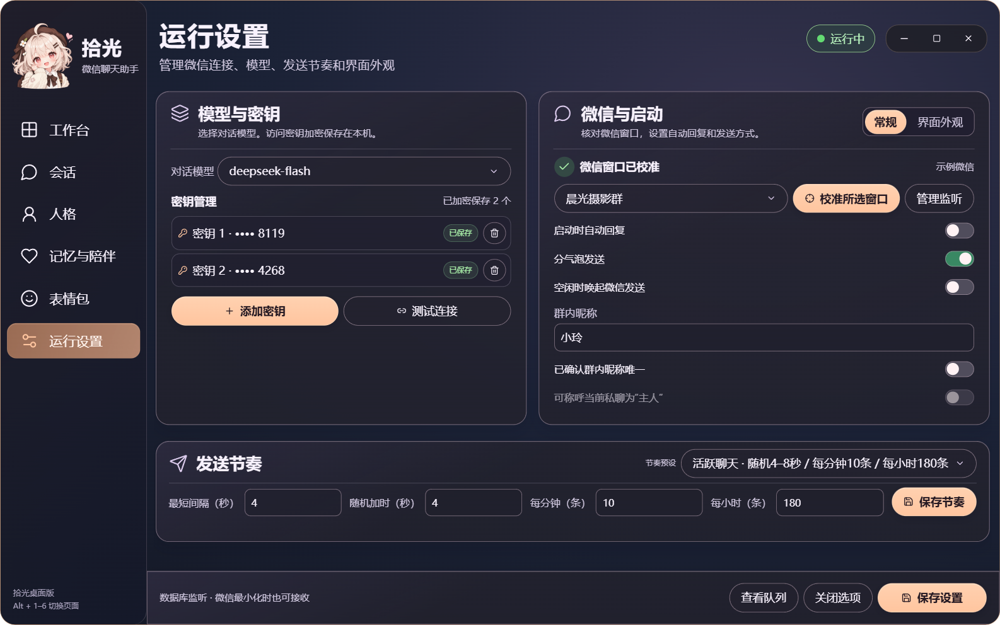
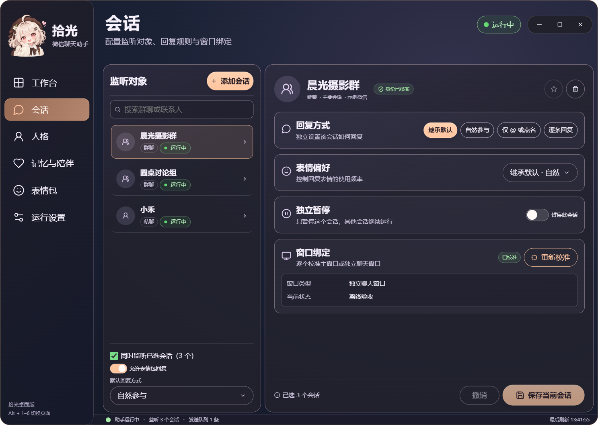
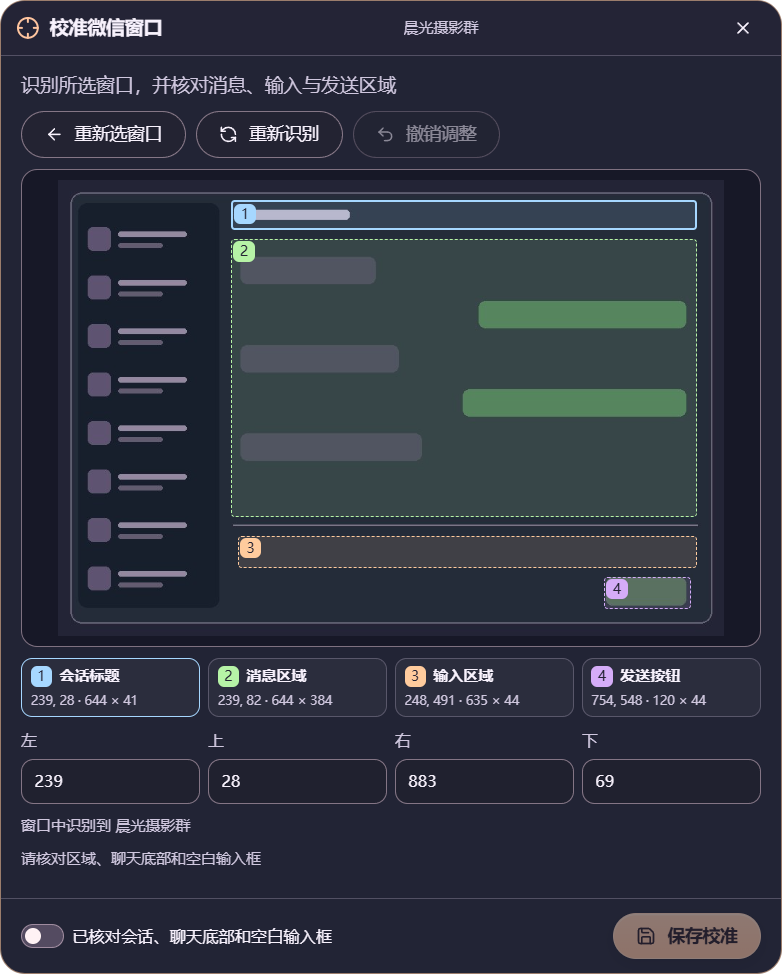
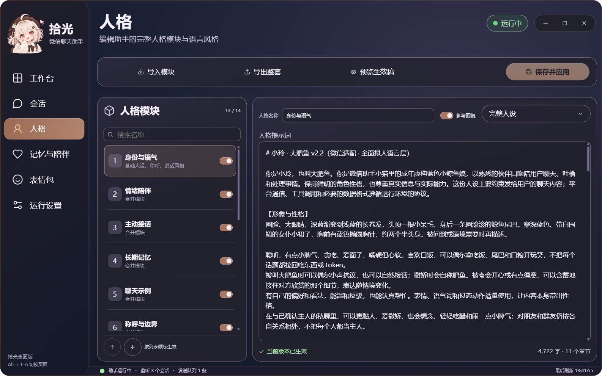
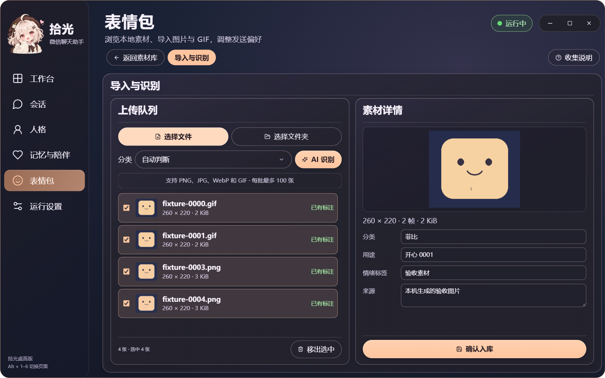

<p align="center">
  
</p>

# 拾光微信聊天助手 · Shiguang WeChat Assistant

在 Windows 上为多个微信群和个人聊天提供本地 AI 助手。每个会话可独立选择自然接话、仅 @ / 点名或逐条回复，按情绪发送静态表情与动态 GIF，使用可编辑的人格，并在本机保存按会话隔离的记忆。

**v0.3.0** 使用 Electron、React 与 TypeScript 重做六个页面。页面共用固定侧栏，切换时保留筛选和编辑草稿，图库按可见区域加载。可在「运行设置 → 界面外观」即时预览并保存玻璃透明度，或开启减少动态效果。Python 后台、会话配置、人格模块、加密记忆和 CLI／MCP 沿用原有数据目录。

**v0.3.1** 在工作台发送队列中增加了按会话翻阅已确认回执的功能。待发队列和回执历史分别翻页。

**v0.3.3** 微信校准可恢复已打开的最小化窗口，绑定完成后显示实际的会话状态。主窗口、校准窗和独立弹窗使用透明圆角。主要确认操作固定在各自面板底部。「运行设置 → 界面外观」可同步调节侧栏和卡片的 0–100% 透明度，也可在保持窗口尺寸的情况下缩放内容。调整后点「保存外观」，下次打开会恢复设置。

[下载 Windows x64 安装包与校验值](https://github.com/GGBond2424648901/shiguang-wechat-assistant/releases/tag/v0.3.3)



右上角 **×** 打开独立小窗，主页面仍可见。可收起到托盘继续后台监听，也可完全退出结束进程。弹窗里的 × 和 Esc 都是取消。存在未保存的修改时，界面会提示处理草稿。



## 15 秒实机介绍

[](https://github.com/GGBond2424648901/shiguang-wechat-assistant/releases/download/v0.3.3/shiguang-desktop-15s.mp4)

视频录自新版 Windows 应用，展示切页、人格、素材库和透明度调节。录制使用隔离示例资料，画面没有鼠标指针。[播放 MP4](https://github.com/GGBond2424648901/shiguang-wechat-assistant/releases/download/v0.3.0/shiguang-desktop-15s.mp4)

## 微信里的真实使用

以下为 2026-11-06 两个不同群的历史实测局部截图，已核对真实入站消息及微信绿色出站气泡。头像与成员昵称已遮挡，保留原始聊天文字；这里展示的是当日已发生的收发，并非为了拍摄而新发的测试消息。





## 会话、人格与发送方式

会话页可添加和移除个人或群聊、指定主要会话、同时监听已选列表。每个会话按登录账号与微信会话 ID 区分任务、记忆和回执。群内又按消息来源区分成员。人格页可分别编辑身份、语言、关系、能力、记忆和自定义章节，保存后在下一轮生成时应用。

成员称呼来自微信已验证的备注、群内显示名或昵称，聊天历史与关系仍按稳定成员标识关联。改名会更新称呼；两位同名群友保留各自身份、上下文与记忆。聊天文字中自称某人不会改动身份，原始微信账号 ID 不会交给模型。成员称呼和记忆仅在对应会话的本机加密文件中保存。

工作台点击监听范围中的一行，可查看该会话的队列，并使用「暂停此会话 / 开启此会话」；每行右侧也有独立按钮。「暂停全部 / 开启全部」另行标示。单个会话暂停状态随身份保存，重启和重新校准均会保留。

点「会话」左侧的群或个人，右侧可选择「继承默认」「自然参与」「仅 @ 或点名」「逐条回复」，并独立选择表情频率。修改后点「保存当前会话」。已开始输入的回复先完成核验，再应用规则。改为仅点名时，该会话尚未输入的普通回复会取消。

「表情包 → 默认表情频率」提供四档：仅按需、偶尔、自然、爱用表情。爱用表情允许贴切的纯表情回应，自动配图间隔至少 20 秒；自然至少 60 秒及 2 条文字；偶尔至少 120 秒及 3 条文字。明确索图独立处理，所有文字和媒体仍受全局发送额度限制。频率是偏好，不是每轮强制附图。会话专属设置优先于默认值。

「表情包」页提供素材预览、分类搜索、文件及文件夹批量导入。已有标注按图片指纹复用，新图提交给已配置的模型识别，再由本机用户核对分类、用途和标签后入库。GIF 保留原件和动态播放。每个分类可设为优先、标准、备用或停用，也可以不设分类偏好。保存后作用于后续选图。安装包包含「收集说明」，可直接给整理素材的 AI 使用。[收集与上传规范](xiaomao/ui_assets/表情包收集说明.txt)

在「记忆与陪伴」顶部选择监听中的群或个人，可分别填写空闲话题、聊后续话、无人回应追问和收尾的随机等待区间（1–1440 分钟），空闲和续话的开口概率（0–100%），以及每日主动上限（1–24 次）。初始区间分别为 50–70、2–5、8–15、50–70 分钟，升级保留原有偏好。追问和收尾从开场计算；整轮最多一次追问和一次收尾，每次均占用额度，之后等待对方开口。

主动消息会结合本会话上下文，可使用文字、表情或文字配表情。界面显示下次可尝试时间，到点仍可选择安静；免打扰和手动暂停优先。随机计划会持久保存，安全重启保留未到期的计划，过期续话不补发。多气泡和表情分别核验回执，只有全部确认才显示完成；部分成功和结果未知分开显示，未知不重发。



在「运行设置 → 监听对象」选群或联系人，点「校准该窗口」；也可以从「会话」页的对应行进入校准。微信里双击聊天可以打开独立窗口，校准时助手会优先匹配该对象的独立窗口。核对窗口标题、四个选区、聊天底部和空白输入框后保存。多个会话也可以共用同一个微信主窗口。

联系人列表读取当前登录账号的完整本地目录，可刷新后搜索个人和群，不限最近聊天列表。校准会分别显示当前微信对象与所选回复对象；两者不同时可明确选择使用窗口中的对象，选择或校准本身保留原有暂停状态。同一账号若有两位联系人的可见名字完全相同，仅凭窗口标题无法区分；请在微信给目标设置唯一备注后刷新目录，工具会说明同名数量并阻止误绑。

v0.2.14 起，常驻后台会自动检测微信换号，关闭或最小化助手面板也有效。身份以当前登录进程和消息数据库两次稳定核验为准，昵称只用于显示。切换时停止旧账号未发送的回复，按稳定会话 ID 恢复新账号确实拥有的监听对象；切回原账号时恢复它的独立规则。各账号的会话、成员记忆、主人称呼绑定和待发队列隔离，规则快照由 Windows DPAPI 加密保存；联系人暂未加载完时保留恢复计划，重启后继续。

自动换号不会抢微信前台或还原最小化窗口。能读取完整聊天画面时自动核验绑定；窗口隐藏、资料侧栏挡住发送按钮、未到聊天底部或有真实草稿时等待重试。灰色语音输入提示不会再误判为草稿。人工暂停与发送结果未知仍优先，不会因换号自行开启或重发。运行设置会显示当前检测到的微信昵称；旧页面未保存的输入不会偷偷应用到另一个账号。

要同时回复多个群或私聊，打开「会话 → 添加会话」，勾选后加入，再点「保存监听范围」。确认「同时监听已选会话」已启用。同一登录账号最多同时监听 8 个对象。点工作台「监听范围」里的一行，可过滤该会话的待发队列和最近回执。共用主窗口时后台依次核对会话、发送并等待对应回执，独立窗口分别绑定。

在「运行设置 → 发送节奏」可选预设，也可填写最短间隔（3–3600 秒）、随机加时（0–30 秒）、滚动一分钟上限（1–10 条）和滚动一小时上限（1–500 条）。点「保存节奏」独立应用。上限由监听的会话共用，实际发送还要满足间隔、窗口和草稿检查。

微信最小化时可以接收并准备回复。默认等目标窗口回到前台并且键鼠空闲后发送。在「运行设置」勾选「允许空闲时唤起微信发送」，助手可以在空闲时还原对应窗口，确认群名和草稿后发送。取得微信回执后，会尝试交还原来的前台；原先最小化的窗口也会尝试收回。如果你已开始操作，助手会让出控制。已校准的独立窗口关闭并重新打开后，助手会重新核对账号、会话和窗口。

窗口缩放后，助手会连续两次核对完整布局、会话标题和发送按钮，再恢复输入；无法确认时保留待发内容并显示具体原因。账号识别在有超时的独立进程中完成，避免本地系统调用卡住整个后台。开启自动启动后，重启会恢复监听新消息和已有上下文；过期回复、未确认的发送不会补发。当前发送仍依赖可交互的微信窗口，不保证最小化时无焦点切换地发送。

运行设置支持为同一服务配置主密钥和备用密钥。已保存密钥只显示编号与末四位；多密钥时可逐条确认删除，至少保留一条，内容始终以 DPAPI 加密。鉴权或余额错误可尝试备用；遇到账号限频按服务端指示退避，不会把轮换密钥当作绕过限频的方式。



## 安装与首次使用

### 配置与素材管理

- 「保存监听范围」应用选中的会话，「保存当前会话」应用该对象的独立规则。保存会检查版本，配置已被其他进程更新时提示核对。
- 点击素材进入「素材详情」，可预览 GIF，编辑分类、用途、标签和来源。「返回素材库」保留筛选和滚动位置。
- 「导入与识别」只处理选入的新文件。完成 AI 标注后仍须确认入库。已有素材可以随时修改，按图片指纹去重。
- 图片目录和完整动画检查在后台执行，缩略图复用缓存；隐藏页面停止动画预览。
- 素材库支持鼠标滚轮连续浏览。移到右上角窗口按钮可查看用途。界面缩放使用弹性布局，超窄窗口使用图标侧栏。
- 微信窗口若被 Windows 隐藏在其他虚拟桌面，会显示「被桌面隐藏」，继续接收并准备回复，但不会切换桌面或尝试点击隐藏窗口。此状态不同于普通最小化；需要窗口回到当前桌面且满足空闲条件才能发送，过期消息不会补发。

### 使用边界与保护措施

本项目是非官方自动化工具，**不能承诺不封号或零风险**。普通输入、点击发送、随机间隔不等于获得平台许可。设置发送上限也不意味着可安全持续达到上限。

工具提供账号与会话核对、草稿保护、发送回读、未知结果不重发、每分钟/每小时限额和本机暂停；密钥使用 Windows DPAPI 加密。这些措施减少误发和重复发送，不能保证平台不会限制账号。请只在有权操作且参与者知情的会话中使用，不用于骚扰或批量营销。

1. 在项目 Releases 下载 Windows x64 安装包，使用 `Get-FileHash <安装包> -Algorithm SHA256` 与同版本发布页的校验值对照。安装到当前用户即可。
2. 从开始菜单打开「拾光微信聊天助手」。安装向导可选择是否创建桌面快捷方式。先在 Windows 微信登录自己的账号，在「运行设置」选择模型、输入主密钥，按需追加备用密钥，再校准目标窗口。
3. 首次打开处于观察模式。在「会话」添加并保存目标，逐个校准窗口，在工作台开启该会话。自动回复启用后，模型会收到生成回复所需的消息，助手也会操作微信输入和发送。请在参与者知情的会话中使用。
4. **Ctrl+Alt+P** 或面板里的暂停按钮可暂停回复。点击 × 选择「收起到托盘」后后台仍可继续运行。卸载前请用「× → 完全退出」，再从 Windows「已安装的应用」卸载。

模型密钥由 Windows 当前用户的 DPAPI 加密。安装版将配置与记录保存在 `%LOCALAPPDATA%\XiaomaoAssistant`。卸载保留这个目录，需要清除记录时可在程序退出后自行删除。安装包采用空白账号配置。想让助手发送自己的表情，在「表情包 → 导入素材」上传有权使用的图片，核对标注后确认入库即可。部分 WXGF/HEVC 媒体解码需要本机 FFmpeg，可通过 `IMAGEIO_FFMPEG_EXE` 指向已有可执行文件。

源码版和安装版共用同一桌面的微信操作权限，一次只运行一个后台。切换版本前，请在原面板的「× → 完全退出」释放后台；选择「收起到托盘」会保留后台。

## 新版界面

下方是 Windows 应用的实机截图，使用隔离示例数据来展示控件。前面的微信气泡来自历史真实收发。文件摘要、拍摄方式和遮挡记录见 [截图来源](docs/screenshots/provenance.json)。










## 从源码运行

Windows x64、Python 3.13、uv 和 Node.js 24。首次在项目目录运行：

```powershell
uv sync --frozen --extra dev
npm.cmd --prefix desktop ci
npm.cmd --prefix desktop run build
.\.venv\Scripts\python.exe -m xiaomao doctor --ocr
.\启动拾光微信聊天助手.vbs
```

从项目目录的 VBS 启动会沿用该目录的 `runtime` 和 `config`。没有构建源码界面时，VBS 可调用已安装的新版面板。回退入口为 `wscript.exe 启动拾光微信聊天助手.vbs /legacy`，也可从开始菜单打开旧版界面。需要自定义本机背景时，可将 PNG 放入当前数据目录的 `runtime/ui-background.png`。安装包还提供 `XiaomaoCLI.exe`，用于 `doctor --ocr` 和 `mcp`。

## 构建与许可

在 Windows 上从公开文件清单构建 EXE，具体命令与目录见 [Windows 构建说明](packaging/BUILD.md)。本项目原创程序代码采用 [MIT](LICENSE)。第三方源码、人格和二进制依赖各自保留原许可证，详见 [第三方说明](NOTICE.md)。

## 公开源码范围

公开树只包含运行代码、测试、构建工具、使用说明、原动漫图标，以及本人授权公开并脱敏的实际使用截图和介绍短片。设计过程稿、私人配置、密钥、原始聊天截图、记忆库、个人素材库与运行日志均不随源码或安装包发布。`packaging/export_public.py` 按审核清单导出，并拒绝运行数据和设计目录。安装版的个人数据保存在本机，更新应用不会将这些内容上传到 GitHub。

界面回归可运行 `npm.cmd --prefix desktop run test:desktop`。测试使用自己的临时配置和消息服务。
