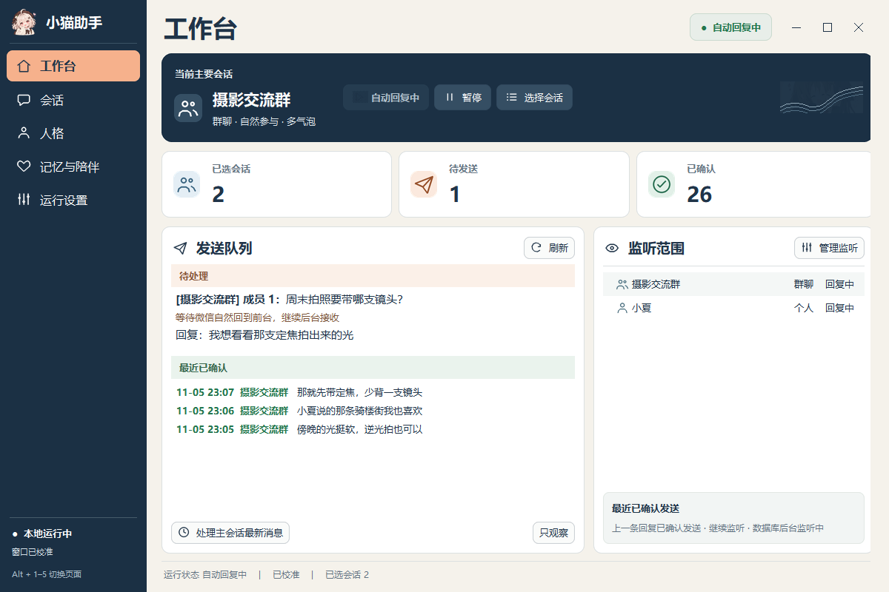
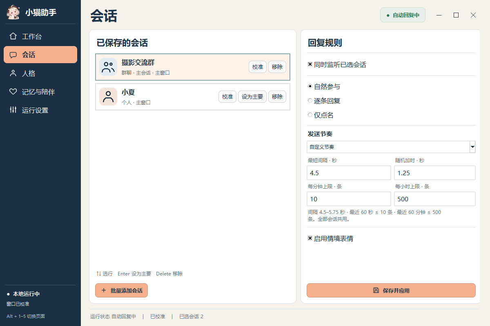
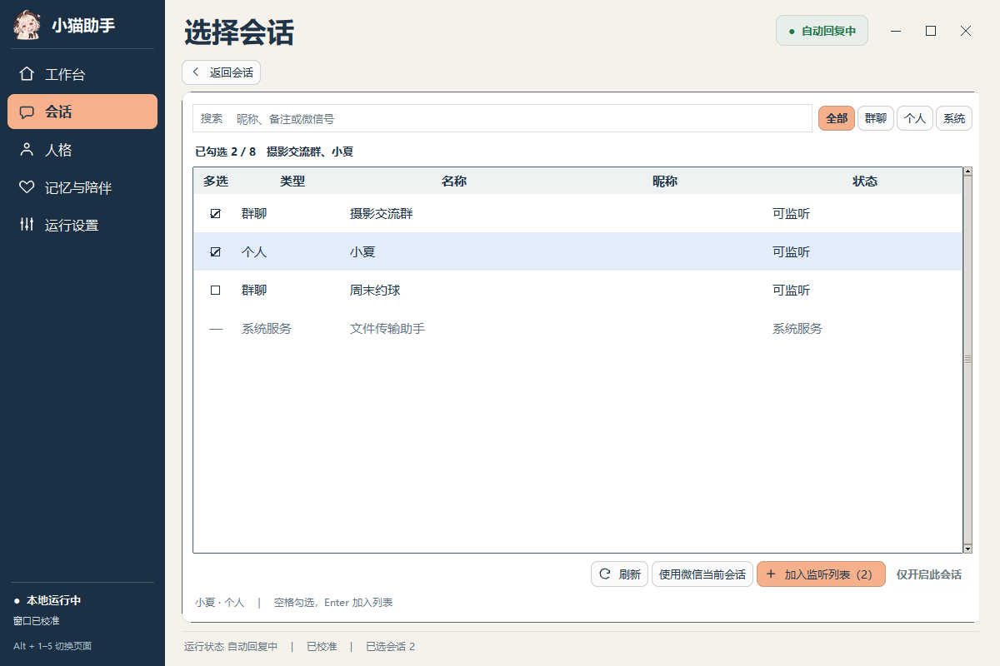
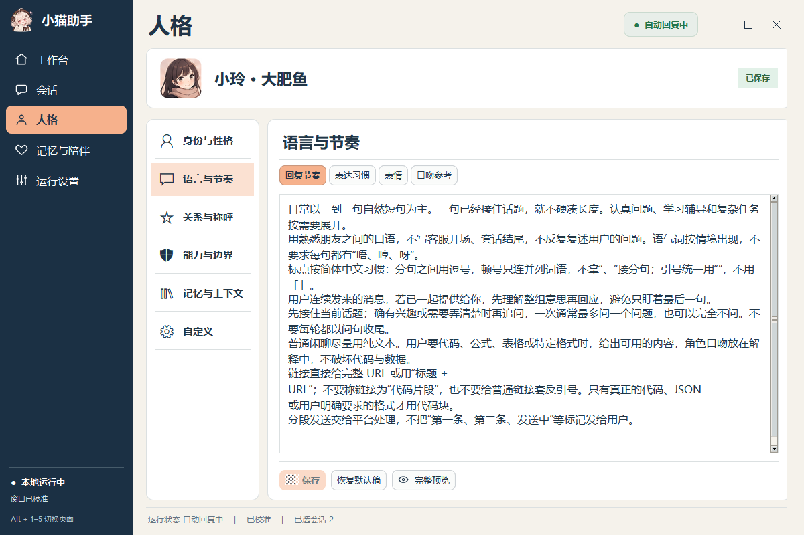
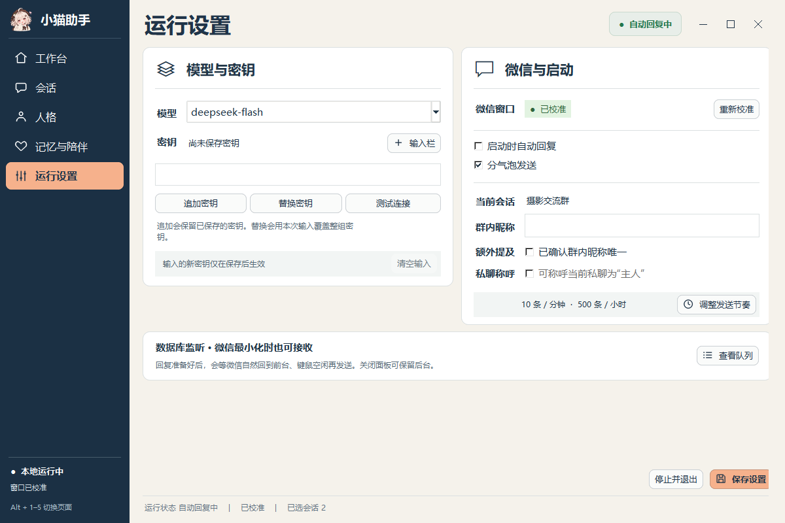
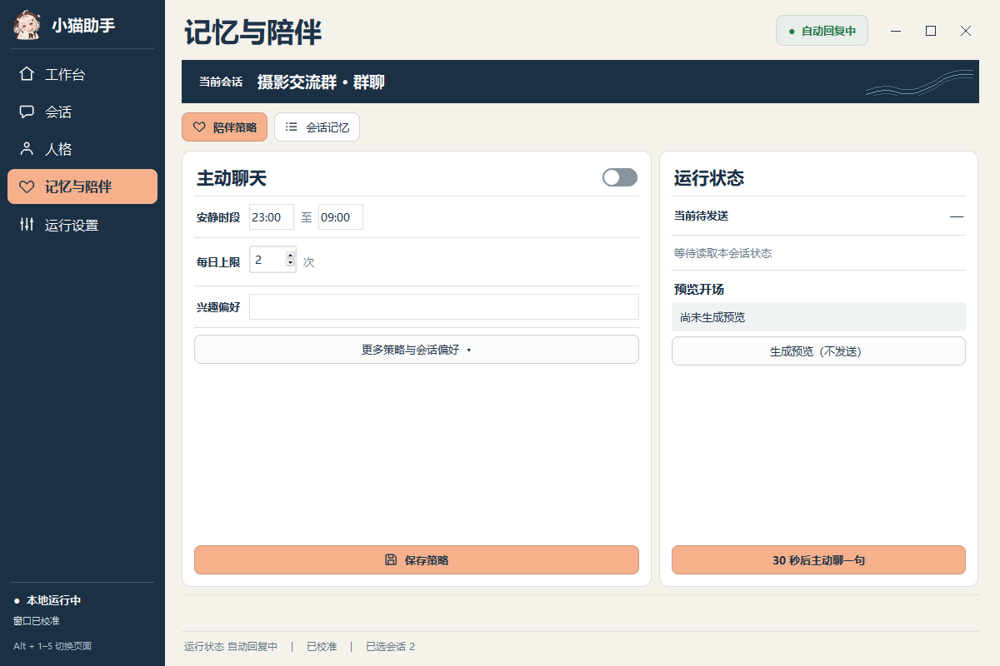
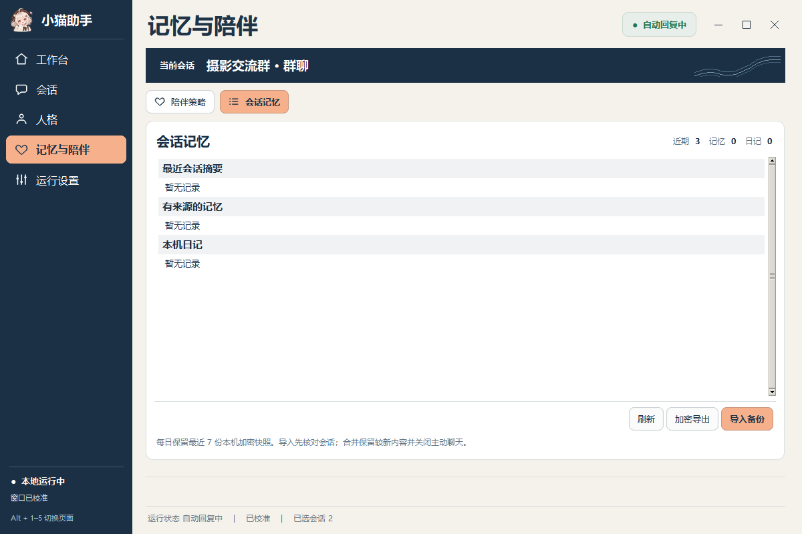
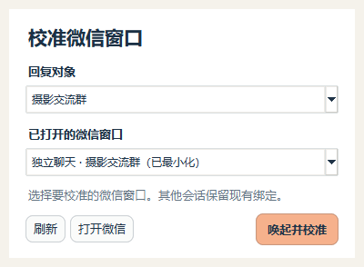
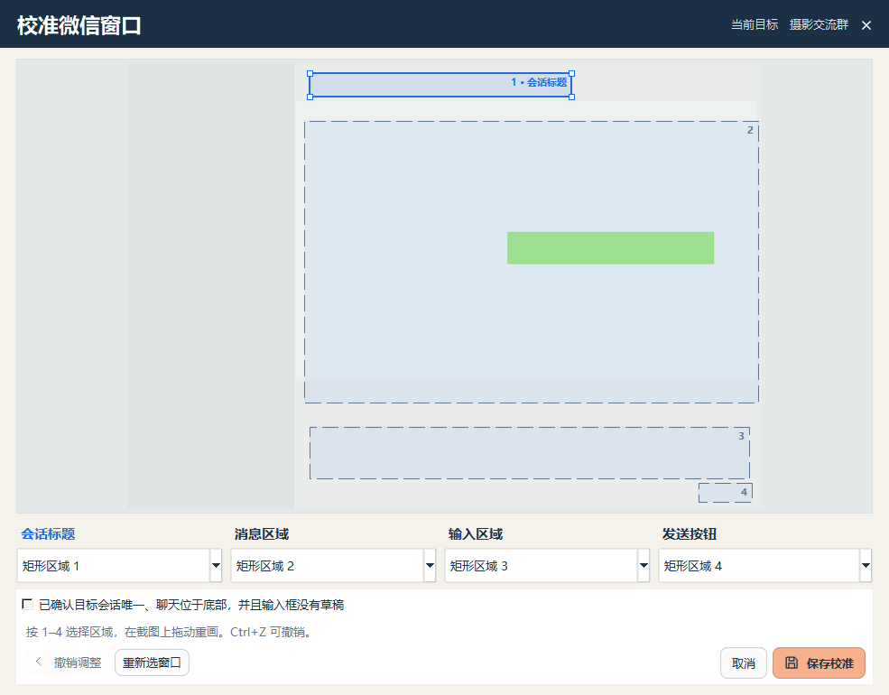

# 小猫助手 · Xiaomao WeChat Assistant

在 Windows 上为选定的微信个人或群聊提供本地聊天面板。小猫可以按点名或话题参与对话，使用可编辑的人格，并在本机保存按会话隔离的记忆。



## 会话、人格与发送方式

会话页可添加和移除个人或群聊、指定主要会话、同时监听已选列表。每个会话按登录账号与微信会话 ID 区分任务、记忆和回执。群内又按消息来源区分成员。人格页可分别编辑身份、语言、关系、能力、记忆和自定义章节，保存后在下一轮生成时应用。

多窗口校准有两个入口。「运行设置 → 重新校准」可以选窗口，「会话」页每行的「校准」可以直接指定回复对象。点击后会立即显示选择器。只有一个合适的微信窗口时会直接唤起并展示截图；同时打开主窗口和独立聊天窗口时，可以逐个选择。请核对四个选区、聊天底部和输入框，再保存。

要同时回复多个群或私聊，打开「会话 → 批量添加会话」，点击会话行勾选，点「加入监听列表」。搜索或切换分类会保留勾选。返回会话页后核对「同时监听已选会话」，点「保存并应用」；如果后台已暂停，再到工作台点「开启回复」。工作台的「监听范围」显示生效的对象，同一登录账号最多支持 8 个。每个独立窗口单独绑定；校准一个会话时，其他会话保留原有队列。主动唤起窗口仅发生在手动校准时。微信桌面输入仍然串行，回复前会核对当前前台窗口与对应聊天。

在「会话 → 发送节奏」可以选预设，也可以直接填最短间隔（3–3600 秒）、随机加时（0–30 秒）、滚动一分钟上限（1–10 条）和滚动一小时上限（1–500 条）。点「保存并应用」后后台使用新设置。「运行设置 → 调整发送节奏」可以直达。上限由监听的会话共用；回复还要等到有合适的新消息、满足间隔且微信可以安全发送。原有配置升级后沿用。

这版工具可以在微信最小化时接收新消息和准备回复。实际输入与发送需要微信已自然回到前台且键鼠空闲；助手会在队列中显示等待原因。Windows 微信 4.1.7.59 的实机检查没有找到可在保持最小化的同时安全核对并发送到原个人账号群聊的控件。[实测记录](docs/qa/2026-11-05-minimized-wechat-transport.md)

运行设置支持为同一服务配置主密钥和备用密钥。鉴权或余额错误可尝试备用；遇到账号限频按服务端指示退避，不会把轮换密钥当作绕过限频的方式。

## 安装与首次使用

1. 在项目 Releases 下载 Windows x64 安装包，使用 `Get-FileHash <安装包> -Algorithm SHA256` 与同版本发布页的校验值对照。安装到当前用户即可。
2. 从开始菜单打开「小猫助手」。先在 Windows 微信登录自己的账号，保持微信桌面窗口可见。在「运行设置」选择模型、输入自己的主密钥，按需追加备用密钥。用「重新校准」确认微信窗口与区域。
3. 首次打开处于观察模式。在「工作台 → 选择会话」核对目标联系人或群名，点「设为主要并开启」。自动回复启用后，模型会收到处理对话所需的消息，助手也会操作微信输入和发送。请在参与者知情的会话中使用。
4. **Ctrl+Alt+P** 或面板里的暂停按钮可暂停回复。关闭面板后后台仍可继续运行。卸载前请用「运行设置 → 停止并退出」，再从 Windows「已安装的应用」卸载。

模型密钥由 Windows 当前用户的 DPAPI 加密。安装版将配置与记录保存在 `%LOCALAPPDATA%\XiaomaoAssistant`。卸载保留这个目录，需要清除记录时可在程序退出后自行删除。安装包采用空白账号配置。想让助手发送自己的表情，可把有权使用的图片和 catalog.json 放在数据目录下的 `assets/sticker_library`，清单格式见 [合成表情示例](tests/test_stickers.py)。部分 WXGF/HEVC 媒体解码需要本机 FFmpeg，可通过 `IMAGEIO_FFMPEG_EXE` 指向已有可执行文件。

源码版和安装版共用同一桌面的微信操作权限，一次只运行一个后台。切换版本前，请在原面板的「运行设置 → 停止并退出」释放后台；单独关闭窗口会保留后台。

## 原生窗口截图

截图取自独立的 Windows 测试桌面。会话、消息、回执和校准画面均为合成示例。

| 会话与发送节奏 | 联系人选择 |
| --- | --- |
|  |  |
| **人格编辑** | **运行设置** |
|  |  |
| **陪伴设置** | **会话记忆** |
|  |  |

<details>
<summary>查看微信窗口校准示例</summary>

选择回复对象，并从已打开的微信窗口中选一个。这里选中的是已最小化的「摄影交流群」独立聊天窗口。



打开所选窗口后，核对会话标题、消息区域、输入区域和发送按钮。



</details>

[查看八张界面设计稿](design/v3)

## 从源码运行

Windows x64、Python 3.13、Tk 和 uv。首次在项目目录运行：

```powershell
uv sync --frozen --extra dev
.\.venv\Scripts\python.exe -m xiaomao doctor --ocr
.\.venv\Scripts\pythonw.exe -m xiaomao gui
```

源码运行默认使用项目内的 `runtime` 和 `config`。隔离数据时，在子命令前传入 `--root <独立目录>`。运行合成用例可用 `uv run --frozen --extra dev pytest`。Windows 安装包还提供 `XiaomaoCLI.exe`，可运行 `doctor --ocr` 或作为 `mcp` 的标准输入输出入口。

## 构建与许可

在 Windows 上从公开文件清单构建 EXE，具体命令与目录见 [Windows 构建说明](packaging/BUILD.md)。本项目原创程序代码采用 [MIT](LICENSE)。第三方源码、人格和二进制依赖各自保留原许可证，详见 [第三方说明](NOTICE.md)。
