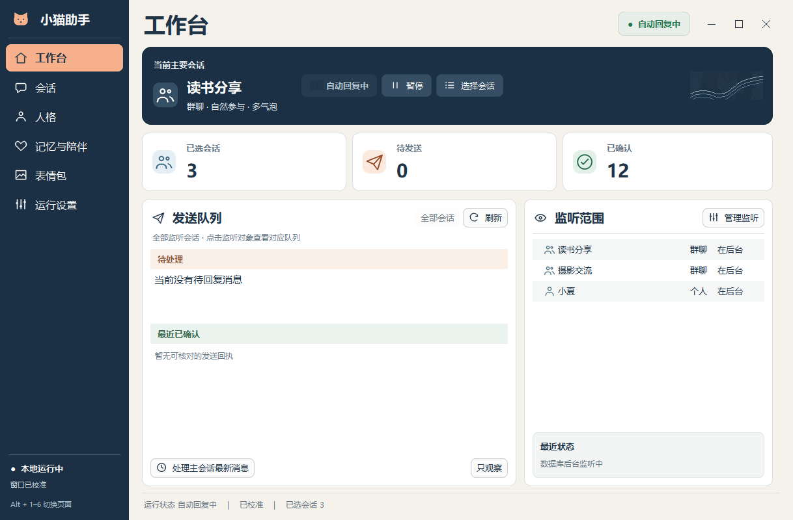
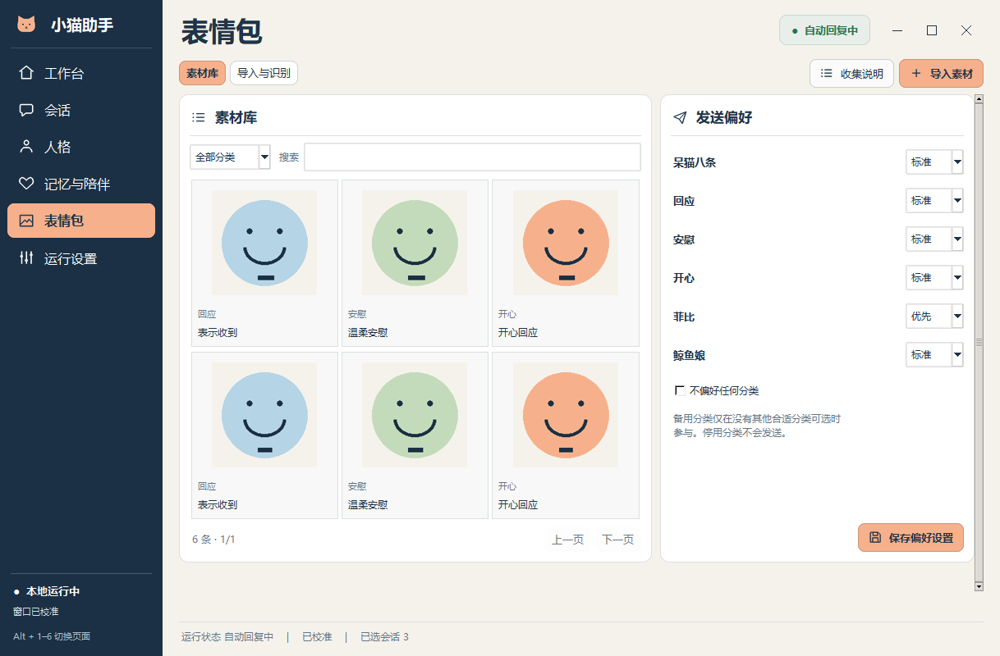
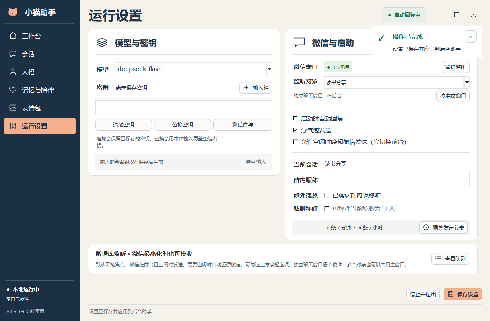

# 小猫助手 · Xiaomao WeChat Assistant

在 Windows 上为选定的微信个人或群聊提供本地聊天面板。小猫可以按点名或话题参与对话，使用可编辑的人格，并在本机保存按会话隔离的记忆。



## 会话、人格与发送方式

会话页可添加和移除个人或群聊、指定主要会话、同时监听已选列表。每个会话按登录账号与微信会话 ID 区分任务、记忆和回执。群内又按消息来源区分成员。人格页可分别编辑身份、语言、关系、能力、记忆和自定义章节，保存后在下一轮生成时应用。

「表情包」页提供素材预览、分类搜索、文件及文件夹批量导入。已有标注按图片指纹复用，新图提交给已配置的模型识别，再由本机用户核对分类、用途和标签后入库。GIF 保留原件和动态播放。每个分类可设为优先、标准、备用或停用，也可以不设分类偏好。保存后作用于后续选图。安装包包含「收集说明」，可直接给整理素材的 AI 使用。[收集与上传规范](xiaomao/ui_assets/表情包收集说明.txt)

在「记忆与陪伴」顶部选择监听中的群或个人，就能单独设置主动聊天。小玲聊完后偶尔在 2–5 分钟补一句；会话安静约一小时后，也可能借原话题自然开口。开启「没人接话时，轻问一次，再自然收尾」后，只有上一条主动消息取得回执才会继续。约 8–15 分钟仍没人回时可以轻问一次，从第一次搭话算起约 50–70 分钟可以收尾，之后等本会话有人再开口。完整一轮占用该会话当天的 3 次主动额度。每一步都可选择安静，免打扰和手动暂停优先。

在「运行设置 → 监听对象」选群或联系人，点「校准该窗口」；也可以从「会话」页的对应行进入校准。微信里双击聊天可以打开独立窗口，校准时助手会优先匹配该对象的独立窗口。核对窗口标题、四个选区、聊天底部和空白输入框后保存。多个会话也可以共用同一个微信主窗口。

要同时回复多个群或私聊，打开「会话 → 批量添加会话」，勾选后点「加入监听列表」，勾选「同时监听已选会话」并保存。同一登录账号最多同时监听 8 个对象。仅调整监听范围或校准窗口时，已经生成的回复会保留在仍受监听的会话里。点工作台「监听范围」里的一行，只看该会话的待发队列和最近回执；点「全部会话」恢复总览。查看队列不会改变监听范围、主要会话或微信前台。共用主窗口时后台轮流定位会话、核对标题、发送并等待对应回执；独立窗口分别绑定。

在「会话 → 发送节奏」可以选预设，也可以直接填最短间隔（3–3600 秒）、随机加时（0–30 秒）、滚动一分钟上限（1–10 条）和滚动一小时上限（1–500 条）。点「保存并应用」后后台使用新设置。「运行设置 → 调整发送节奏」可以直达。上限由监听的会话共用；回复还要等到有合适的新消息、满足间隔且微信可以安全发送。原有配置升级后沿用。

微信最小化时可以接收并准备回复。默认等目标窗口回到前台并且键鼠空闲后发送。在「运行设置」勾选「允许空闲时唤起微信发送」，助手可以在空闲时还原对应窗口，确认群名和草稿后发送。取得微信回执后，会尝试交还原来的前台；原先最小化的窗口也会尝试收回。如果你已开始操作，助手会让出控制。已校准的独立窗口关闭并重新打开后，助手会重新核对账号、会话和窗口。

运行设置支持为同一服务配置主密钥和备用密钥。鉴权或余额错误可尝试备用；遇到账号限频按服务端指示退避，不会把轮换密钥当作绕过限频的方式。

## 安装与首次使用

1. 在项目 Releases 下载 Windows x64 安装包，使用 `Get-FileHash <安装包> -Algorithm SHA256` 与同版本发布页的校验值对照。安装到当前用户即可。
2. 从开始菜单打开「小猫助手」。先在 Windows 微信登录自己的账号。在「运行设置」选择模型、输入主密钥，按需追加备用密钥。用「校准该窗口」确认微信窗口与区域。
3. 首次打开处于观察模式。在「工作台 → 选择会话」核对目标联系人或群名，点「设为主要并开启」。自动回复启用后，模型会收到处理对话所需的消息，助手也会操作微信输入和发送。请在参与者知情的会话中使用。
4. **Ctrl+Alt+P** 或面板里的暂停按钮可暂停回复。关闭面板后后台仍可继续运行。卸载前请用「运行设置 → 停止并退出」，再从 Windows「已安装的应用」卸载。

模型密钥由 Windows 当前用户的 DPAPI 加密。安装版将配置与记录保存在 `%LOCALAPPDATA%\XiaomaoAssistant`。卸载保留这个目录，需要清除记录时可在程序退出后自行删除。安装包采用空白账号配置。想让助手发送自己的表情，在「表情包 → 导入素材」上传有权使用的图片，核对标注后确认入库即可。部分 WXGF/HEVC 媒体解码需要本机 FFmpeg，可通过 `IMAGEIO_FFMPEG_EXE` 指向已有可执行文件。

源码版和安装版共用同一桌面的微信操作权限，一次只运行一个后台。切换版本前，请在原面板的「运行设置 → 停止并退出」释放后台；单独关闭窗口会保留后台。

## 界面预览

以下截图来自实际 Windows 原生界面，会话、消息与表情全部使用虚构示例。可运行 `packaging/preview_ui.py` 重新生成。





点击保存、开启回复、校准和导入后，面板会显示进度与结果。处理中阻止重复提交，失败提示保留到关闭或下一次操作。替换密钥需要确认；取消不会丢失原密钥或当前输入。反馈在助手窗口内显示，不会唤起微信。

## 从源码运行

Windows x64、Python 3.13、Tk 和 uv。首次在项目目录运行：

```powershell
uv sync --frozen --extra dev
.\.venv\Scripts\python.exe -m xiaomao doctor --ocr
.\.venv\Scripts\pythonw.exe -m xiaomao gui
```

源码运行默认使用项目内的 `runtime` 和 `config`。隔离数据时，在子命令前传入 `--root <独立目录>`。运行合成用例可用 `uv run --frozen --extra dev pytest`。Windows 安装包还提供 `XiaomaoCLI.exe`，可运行 `doctor --ocr` 或作为 `mcp` 的标准输入输出入口。

## 构建与许可

在 Windows 上从公开文件清单构建 EXE，具体命令与目录见 [Windows 构建说明](packaging/BUILD.md)。本项目原创程序代码采用 [MIT](LICENSE)。第三方源码、人格和二进制依赖各自保留原许可证，详见 [第三方说明](NOTICE.md)。

## 公开源码范围

公开树只包含运行代码、测试、构建工具、使用说明、通用图标与合成截图。设计过程稿、私人配置、密钥、聊天记录、记忆库、素材库与运行日志均不随源码或安装包发布。`packaging/export_public.py` 按审核清单导出，并拒绝运行数据和设计目录。安装版的个人数据保存在本机，更新应用不会将这些内容上传到 GitHub。
