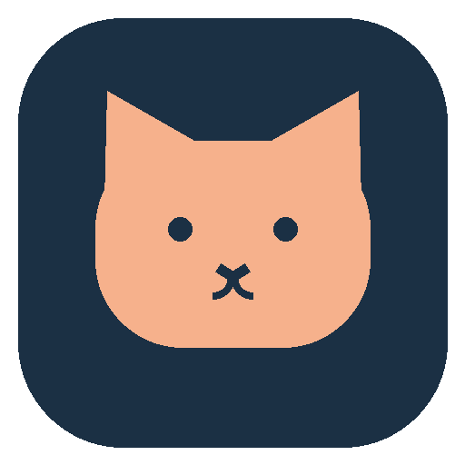
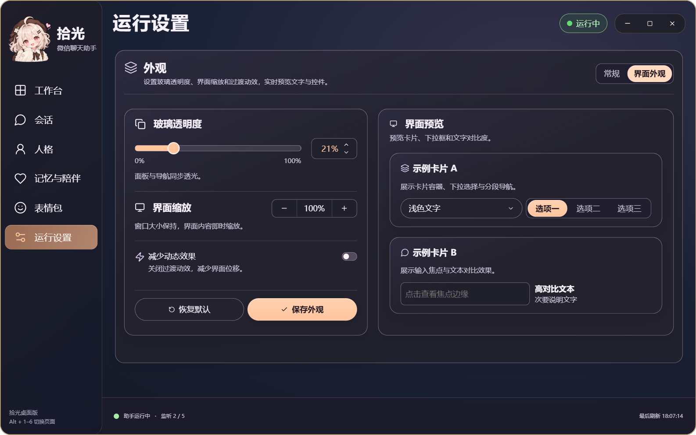
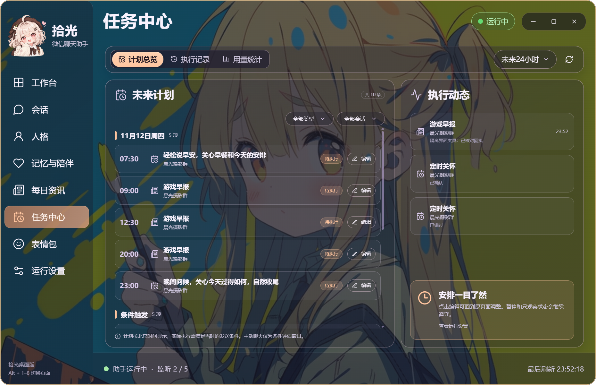
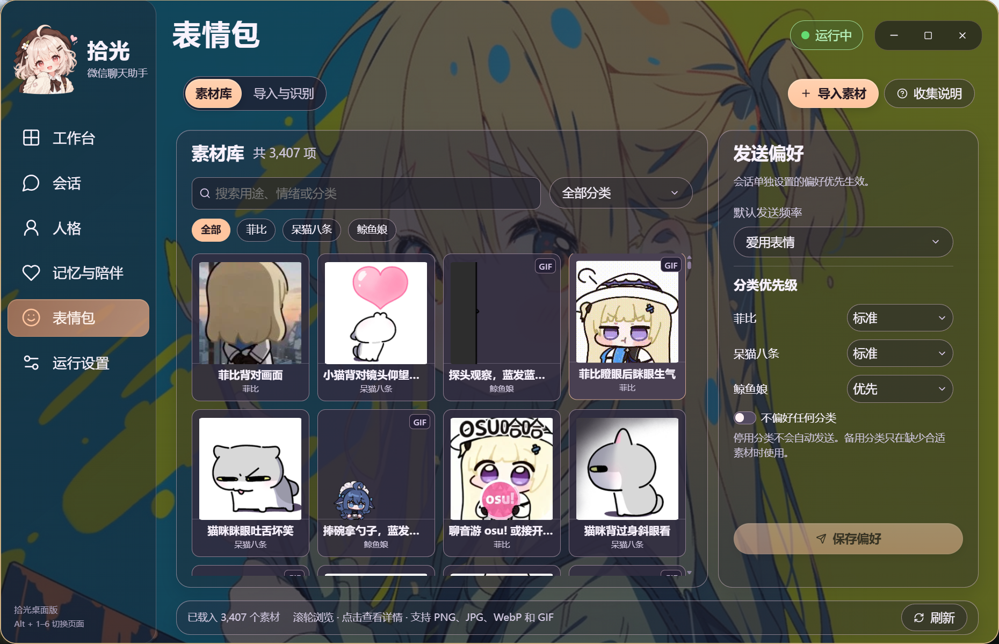

<p align="center">
  
</p>

<h1 align="center">拾光微信聊天助手</h1>
<p align="center">让微信里的聊天，有个能接话、记事、发表情的小伙伴</p>
<p align="center">
  <a href="https://github.com/GGBond2424648901/shiguang-wechat-assistant/releases/latest">下载安装包</a> ·
  <a href="#开始使用">开始使用</a> ·
  <a href="#一些使用上的实际情况">使用前看看</a>
</p>

这是一个在 Windows 上运行的微信 AI 助手。登录自己的微信，选好要回复的群或朋友，就可以让它参与聊天。能接普通消息，也能只在被 @ 时回答；想让不同群有不同的相处方式，可以分别设置。

我做它，是想要一个有自己语气、记得前文、会用表情接梗的聊天伙伴。人格可以自己写，也可以拆成几个模块慢慢调。聊天效果仍取决于模型、上下文和你的设定，工具负责把这些接到微信里。


> 以下为实机截图；个人会话、聊天和人格设定未用于展示。安装包中的默认人格为通用设定。



## 平时怎么用

**几个群和私聊，可以一起开。** 最多同时监听 8 个会话。工作台将触发消息与实际回复并排展示，待发送和已确认计数放在发送队列内；还能看到每个对象的状态并单独开启、暂停，不必把所有人一起停掉。

**每个会话有自己的回复方式。** 比如朋友私聊正常接话，热闹群只在被 @ 或点名时回应，另一个群用自然参与。也保留了逐条回复选项。设置保存后，重启会沿用。

**想亲自聊一会，可以让助手临时休息。** 在会话页或工作台选休息时长，查看倒计时，随时提前结束。到期核对后恢复原状态，新的手动暂停和身份变化优先。

**文字和表情一起聊。** 可以分成几条消息发出，也能挑一张合适的表情接话。GIF 使用原动画，不会先转成静态图片再发。你能自己导入素材、改标签，设置喜欢的分类和使用频率。

**上下文按会话分开。** 群成员按消息来源区分，昵称用于称呼；私聊也有自己的历史、摘要和记忆。换群不会把上一处的私事带过去。

**没人在说话时，也可以主动开口。** 在“记忆与陪伴”里设置空闲聊天、跟进和定时问候。间隔、概率、每日次数都能调，也能完全关闭。

**每天的资讯，也可以送到微信。** “每日资讯”支持游戏、动漫、音乐、电竞、美食、国际、科技等 18 个方向，既能单选、多选，也能为分类添加具体主题，例如游戏里的“三角洲”、体育里的“张雪摩托”。每个订阅支持多个固定时间和按间隔推送的时间段，分别设置星期、每期条数及目标群或朋友。可以先看预览，再立即推送或启用计划。每条资讯保留真实来源；未核实的发布时间会明确标注，推送记录按目标显示微信回执。

定时推送需要电脑、微信和助手后台保持运行。暂停会话不会被资讯功能自动开启；恢复后只补最近且仍在两小时窗口内的一轮，重叠时间只推送一次。重启、取消和多个订阅之间会核对来源与发送记录，回执不明的内容会停止重发。新订阅默认关闭，升级后不会自动向已有群推送。详细操作见[每日资讯说明](docs/daily-news.md)。

每个主题还可单独设置别名、关注点和排除词；资讯支持公开 RSS / Atom 来源、来源优先级、保守的同事件转载合并，以及可撤销的喜欢/无关/重复反馈。

**未来有什么安排，在「任务中心」一起看。** 统一查看资讯和定时关怀的未来计划、主动聊天的评估窗口及执行记录；还可查看真实调用、采集、tokens、耗时与当前队列等待情况，填写单价估算费用。「运行设置 → 运行诊断」可检查后台、账号、校准、模型及公共检索。操作说明见[任务中心与进阶功能](docs/workspace-guide.md)。



上图使用隔离的示例会话和任务数据，展示实际安装版界面；没有使用个人聊天和订阅配置。v0.3.18 的验证范围见[验收记录](docs/superpowers/plans/2026-11-11-assistant-workspace-verification.md)。


## 人格与陪伴

公开版只提供两句通用提示：“你是拾光，一个友好、可靠的微信聊天助手。请结合上下文自然、清晰地回答，并尊重对方意愿。” 可以自行编辑或导入人格模块；发布包不含作者个人设定，升级也不会覆盖已有配置。

人格页可以编辑原文、调整模块顺序、启停模块，保存后查看实际生效的内容。身份、语言习惯、情绪和关系不用塞进一个难找的大文本框。已有的自定义规则会保留，升级不会替你改写。

**人格试聊入口：左侧「人格」→ 顶部「人格试聊」**，与「人格编辑」并列，选中项会高亮。输入文字后点击「发送试聊」或按 Ctrl + Enter，使用当前编辑稿测试多轮回复，试聊与正式会话记忆分开。记忆与陪伴中的「会话总结」可以按会话和时间范围整理已有文字记录，先看预览，再自行选择是否发送。十项进阶功能的具体入口见[使用说明](docs/workspace-guide.md)，本轮修复见[v0.3.19 复核记录](docs/superpowers/plans/2026-11-12-persona-entry-verification.md)。


记忆和主动聊天在同一个页面，先选会话，再看这段关系里记住了什么、有哪些安排。生成预览可以先看效果；真正发出后会留下发送记录。


## 自己准备表情包

在“表情包”里选择文件或文件夹，识别分类、用途和情绪标签，核对后入库。已经导入的素材，点开就能修改，不需要再导入一次。

可以给喜欢的分类设优先级，也能停用某一类。表情频率既有全局默认值，也能针对某个群或朋友单独设置。频率是使用偏好，不是每条消息强行配图。




整理素材时可以把这份 [收集说明](xiaomao/ui_assets/表情包收集说明.txt) 交给帮你整理的 AI。

## 开始使用

1. 从 [Releases](https://github.com/GGBond2424648901/shiguang-wechat-assistant/releases/latest) 下载 Windows x64 安装包。安装时可以选择创建桌面快捷方式。
2. 登录 Windows 微信，在助手的“运行设置”里填写模型密钥。保存后可测试连接；有备用密钥时可以追加，也可以单独删除。
3. 在“会话”里添加想监听的群或联系人。点校准，选择对应微信窗口，核对标题、消息区、输入区和发送按钮后保存。聊天可以共用微信主窗口，也可以拖成独立窗口分别校准。
4. 回工作台，开启需要回复的会话。先在熟悉的小范围里试一试，观察语气和频率是否合适。


发送节奏可以直接填数值：最短间隔、随机加时、每分钟和每小时上限。几个会话共用总额度，避免一起发消息时突然刷屏。


### 换版本时，原来的东西还在吗

程序和个人数据分开保存。普通安装默认使用 `%LOCALAPPDATA%\XiaomaoAssistant`；从已有项目目录的 `启动拾光微信聊天助手.vbs` 打开安装版，会登记这处现有数据目录，以后从安装快捷方式打开也沿用它。登记只保存路径，不搬走聊天记录，也不覆盖人格。

v0.3.4 起，VBS 会检查新版程序和界面构建的版本。文件缺失或太旧时会说明原因，不再自动退回旧界面。如果旧面板还在托盘里运行，会提示先完全退出，不会把旧面板当成新版唤回来。已登记的数据目录找不到时也会报错，不会偷偷换成空白配置。请保留原数据目录；如果在移动硬盘上，先接好再打开。

### 关闭窗口，不一定要停掉助手

点右上角 **×**，会出现独立小窗：

- **收起到托盘**：关掉面板，后台继续运行
- **完全退出**：结束本实例的界面、监听和定时任务
- **取消**：回到刚才的页面


需要立刻暂停，可以按 **Ctrl + Alt + P**。原来手动暂停的会话不会因为重新打开界面就自动开启。

## 界面可以按喜好调整

“运行设置 → 界面外观”里，侧栏和内容卡片的玻璃透明度一起调节，范围 0–100%。这里的 100% 是露出应用背景，不是让文字消失。内容缩放支持 75–200%，不会跟着改变窗口宽高。调整好以后点保存。

想换背景，把 PNG 放到当前数据目录的 `runtime/ui-background.png`。不放图片时使用默认深色背景。


## 一些使用上的实际情况

- **后台接收和后台发送不是一回事。** 微信最小化时可以读取新消息并准备回复。发送仍需要可交互的微信窗口；开启“空闲时唤起微信发送”后，会在空闲时还原窗口并尝试交还焦点。不能保证全程不切前台。
- **独立窗口的发送按钮未核实。** 窗口已经显示，但程序无法确认校准位置仍在发送按钮上。请确保右下角按钮完整可见。如果微信改了按钮位置，在「会话 → 重新校准」框选整个发送按钮，避免把输入框或其他控件框进去。
- **修改回复方式。** 选中目标会话，选择「继承默认」「自然参与」「仅 @ 或点名」或「逐条回复」，再点「保存当前会话」。设置按会话保存。正在发送的消息完成后，后台会应用新规则。
- 微信被放到其他虚拟桌面、输入框里有你自己的草稿，或窗口身份无法确认时，工具会等待。队列里的“已生成”不等于已经发出，完成以微信回执为准。结果未知的消息不会自动重发。
- 密钥使用 Windows DPAPI 加密。聊天与记忆保存在本机；生成回复所需的上下文、图片会发送给你配置的模型服务。请选自己信任的服务。
- 多密钥用于正常的故障切换，不能保证绕过模型服务的限频。
- 这是非官方工具，普通点击输入和随机延迟也不能保证不封号。请在参与者知情的会话里使用，不用于骚扰、刷屏或批量营销。

## 从源码运行

需要 Windows x64、Python 3.13、uv 和 Node.js 24。在项目目录运行：

```powershell
uv sync --frozen --extra dev
npm.cmd --prefix desktop ci
npm.cmd --prefix desktop run build
.\.venv\Scripts\python.exe -m xiaomao doctor --ocr
.\启动拾光微信聊天助手.vbs
```

VBS 优先打开符合版本要求的安装版，沿用项目数据；没有安装版时使用已构建的源码界面。检查它准备打开哪里，可以运行 `cscript.exe 启动拾光微信聊天助手.vbs /check`。旧界面仅作为显式回退入口：`wscript.exe 启动拾光微信聊天助手.vbs /legacy`。

界面采用 Electron + React + TypeScript，微信收发、模型、记忆和调度由 Python 后台处理。CLI 和 MCP 入口仍保留。构建安装包见 [构建说明](packaging/BUILD.md)，界面回归运行 `npm.cmd --prefix desktop run test:desktop`。

## 开源说明

原创代码使用 [MIT](LICENSE)，引用的第三方项目与依赖见 [NOTICE](NOTICE.md)。公开包不带私人聊天、密钥、记忆库、个人表情库或个人背景原图。截图来源、版本和脱敏记录见 [截图记录](docs/screenshots/provenance.json)。
